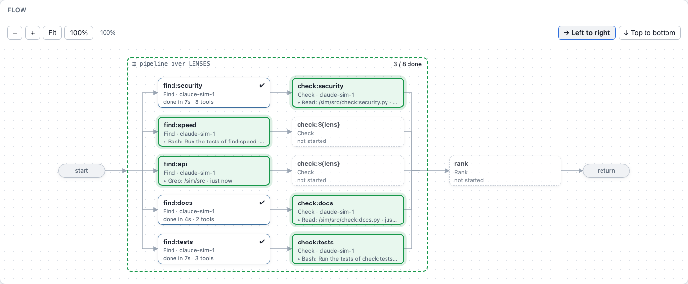
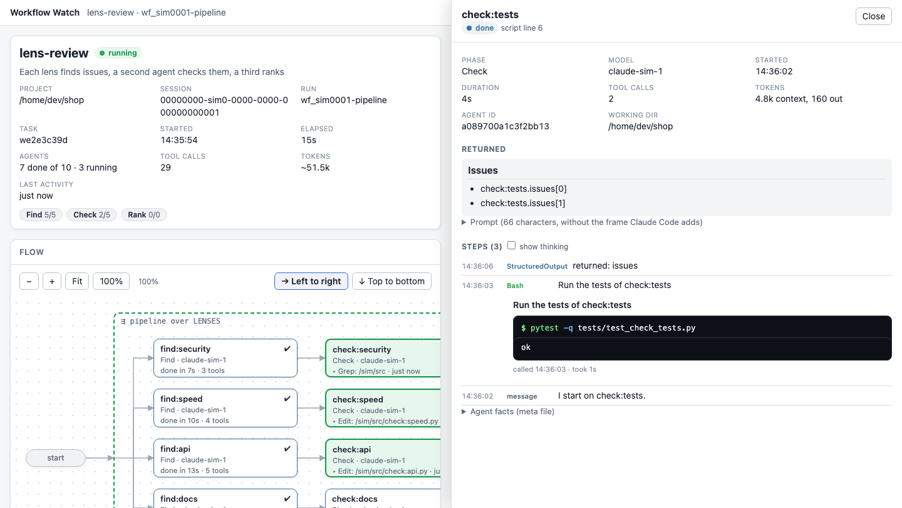

# Workflow Watch

A live, local viewer for Claude Code **Workflow** runs: the multi-agent
scripts Claude starts with the `Workflow` tool (dynamic workflows,
`ultracode`, `/deep-research`, saved workflows).

It draws each run as a flow of its agents, like n8n, and updates the flow
while the run works. A working agent has a green frame. Click it to see what
it is doing now, every step it took, and what it returned.



The terminal has `/workflows` for this, but only for the session that started
the run. Workflow Watch shows every run of every project on the computer, from
any surface: the CLI, the VS Code or JetBrains extension, the Desktop app.

## What you need

- Claude Code with dynamic workflows (see
  [Orchestrate subagents with dynamic workflows](https://code.claude.com/docs/en/workflows)).
- Python 3.9 or later. Nothing else: no packages, no build step, no internet.
  macOS ships Python 3.9; on Windows use `py`.
- A browser.

## Start

```sh
git clone <this repository> workflow-watch
cd workflow-watch
python3 workflow_watch.py
```

A page opens at `http://127.0.0.1:7766/` (the next free port if that one is
taken). Leave the command running while you watch; press Ctrl+C to stop it.

You do not need to set anything up per project. The tool reads every project
Claude Code has on this computer, and a new run shows up on the page by itself
as soon as it starts.

To use it on another computer, copy the single file `workflow_watch.py` and run
it there. The rest of the repository is tests and tools for development.

In VS Code you can keep the page next to your code: run **Simple Browser:
Show** from the command palette and enter the address.

## What you see

**The run list.** Every run, newest first: status (running, finished, stopped,
probably stopped, awaiting launch), workflow name, project folder, start time,
duration, agents done, tokens and last activity. You can filter by project,
by name, or show running runs only. A Workflow call that waits for your
approval is already listed, as "awaiting launch".

**The run page.** The run's name, description, project, ids, times and totals;
the flow; the agents grouped by phase; the `log()` lines; the value the script
returned; the input (`args`) and the script source.

**The flow.** Drawn from the run's own script, so you see the whole plan before
the agents reach it:

- every `agent()` call is a box; boxes that have not started are dashed,
  working ones have a green frame, finished ones a tick, failed ones are red;
- `parallel()`, `pipeline()`, `.map()` and `Array.from()` fan-outs open into one
  column per item (up to 24; more stay one box with a count), and a fan-out
  inside a column opens into columns of its own;
- loops are boxes that show their round, `if` and `switch` show their
  condition and branches, `break` and `return` end a path;
- a child `workflow()` is a box that fills with the child's agents;
- the flow runs left to right; a button switches to top to bottom.

The page places each agent of the run on the `agent()` call that started it:
by its label template (`review:${file}`), by the text its prompt starts with
when it has no label, and by its phase. It knows nothing about any particular
workflow. An agent it cannot place is listed under the flow.



**The agent panel** (click a box or a row): what the agent is doing now (its
last tool call and how long ago), its last message, what it returned (field
names as headings, Markdown shown as Markdown), its prompt, and every step,
newest on top. Open a step to see it in a form that fits the tool: a terminal
for Bash, a diff for Edit, the file with line numbers and colours for Read and
Write, the image itself when the agent read an image (PNG, JPEG, GIF, WebP;
click it to open it full size), the matches for Grep and Glob, the question and
answer for WebFetch and WebSearch. The page updates the panel in place, so what you read does not
move.

## Options

| Option | What it does |
| --- | --- |
| `--port N` | Serve on this port of 127.0.0.1. |
| `--root DIR` | Read this Claude projects folder. Default: `$CLAUDE_CONFIG_DIR/projects`, else `~/.claude/projects`. |
| `--no-browser` | Do not open a browser. |
| `--stale-minutes M` | A run without an end record whose files did not change for M minutes is shown as "probably stopped" (default 45). A long tool call writes nothing while it runs, so keep this generous. |
| `--scan-days D` | Read session transcripts changed in the last D days (default 3). Older finished runs still show, from their end records. |

## Try it without a real run

With Node.js installed you can play an invented run into a scratch folder and
watch it live. The simulator runs any workflow script against a fake runtime
and writes the same files Claude Code writes:

```sh
node tools/simulate_workflow.js --root /tmp/ww-demo \
  --script tests/scenarios/pipeline_lenses.js \
  --args '{"lenses": ["security", "speed", "api"]}' --step-ms 1500 &
python3 workflow_watch.py --root /tmp/ww-demo
```

`tests/scenarios/` has more shapes to try, and you can point `--script` at a
workflow script of your own. The simulator refuses to write under `~/.claude`.

## Privacy and safety

- It only reads. It never writes, moves or deletes anything in the Claude
  folder.
- The server listens on 127.0.0.1 only and answers only requests addressed
  to `127.0.0.1` or `localhost`, so another web page cannot read your
  transcripts through it.
- Transcripts hold source code and command output, and may hold secrets. The
  page treats them as untrusted text: it never turns them into HTML, and it
  runs under a strict Content Security Policy.
- It makes no request to any other host.

## How it works, and what it depends on

Claude Code writes a run's progress to files under
`~/.claude/projects/<project>/`. They are internal files, not a documented
interface: a Claude Code update can change them. They were checked against
Claude Code 2.1.325 on macOS (CLI and VS Code extension).

| File | What the tool reads in it |
| --- | --- |
| `<session>.jsonl` | the `Workflow` tool call (script or script path, args), its result (run id, task id, workflow name), and the task notifications (completed, stopped) |
| `<session>/subagents/workflows/<run>/journal.jsonl` | one line when an agent starts (`label`, `phase`, `key`) and one when it returns (`result`); written live |
| `<session>/subagents/workflows/<run>/agent-<id>.jsonl` | the agent's transcript: its prompt, messages, tool calls and results, token use; written live |
| `<session>/subagents/workflows/<run>/agent-<id>.meta.json` | the agent's label, phase and model |
| `<session>/workflows/<run>.json` | the end record: status, times, totals, logs, result, script; written only when the run ends |

Each file is read incrementally: only what was added since the last read.

Facts the page relies on, seen with real runs:

- A run without an end record is running while its files change.
- After a session restart Claude Code can report a run as "stopped" while its
  agents go on working; when the files keep changing, the page shows the run
  as running and says why.
- An agent without a `label` is named by the first 60 characters of its
  prompt.
- A child `workflow()` runs inside the same run; its agents have the phase
  `▸ <child name>`.
- Resuming a run keeps its run id. Replayed agents write nothing and are
  marked `cached` in the new end record; until that record is written, the
  page shows the run as running.

Not checked yet: an agent restarted after a stall, and Windows and Linux.

A workflow started by name finds its script in `.claude/workflows/` of the
project folder or a parent, in the personal `workflows/` folder of the Claude
configuration folder, or in a plugin's `workflows/` folder. A bundled workflow
such as `/deep-research` has no script file; its flow is drawn from its agents
by phase.

## When something looks wrong

- **No runs at all.** Check the folder in the line under the list. If you set
  `CLAUDE_CONFIG_DIR` for Claude Code, set it for this command too, or pass
  `--root`.
- **A run you know is running shows "probably stopped".** One of its agents is
  in a long, silent tool call. Raise `--stale-minutes`.
- **A note on the run page says lines could not be read**, or the counts look
  odd after a Claude Code update: the file formats changed. Run the tests,
  compare a real run folder with the table above, and see `SessionIndex`,
  `Run`, `AgentTranscript` and `Store` in `workflow_watch.py`; the flow code is
  in `GRAPH_JS` (`buildGraph`, `matchAgents`, `expandFanouts`).

## Development

```sh
python3 -m unittest discover -s tests
```

| Path | What it is |
| --- | --- |
| `workflow_watch.py` | the whole tool: the server, the page, its styles and scripts |
| `tests/test_workflow_watch.py` | the file readers, statuses and HTTP, on small invented run folders |
| `tests/test_scenarios.py`, `tests/scenarios/` | many workflow shapes run in the simulator; checks that every agent lands on the `agent()` call that started it, once (needs Node.js) |
| `tests/test_graph.py`, `tests/*_cases.js` | the flow builder, the syntax highlighter, the Markdown reader and the line diff (needs Node.js) |
| `tools/simulate_workflow.js` | the fake workflow runtime |
| `tools/simulate_run.py` | a fixed invented run, without Node.js |
| `tools/vendor_acorn.py` | replaces the embedded JavaScript parser |

Tests without Node.js skip the parts that need it.

## License

MIT License, Copyright (c) 2026 Engincan Kaya. See [LICENSE](LICENSE).

## Third-party code

The page reads workflow scripts with [acorn](https://github.com/acornjs/acorn)
8.14.0 (MIT licence), embedded unchanged at the end of `workflow_watch.py`
together with its licence text.
